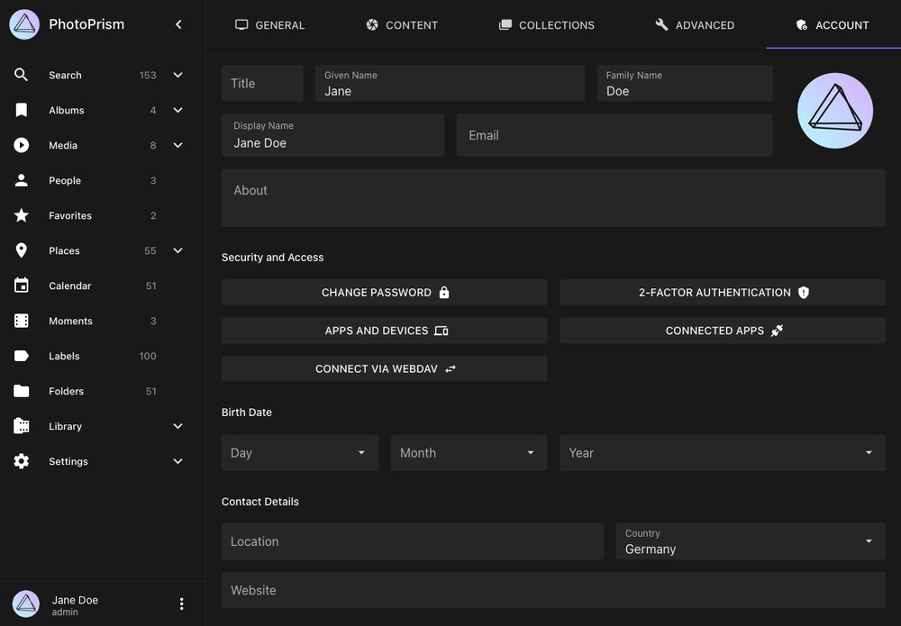

# Connecting AI Agents With MCP

<!-- Screenshots: ui.photoprism.app, build 261029-963b58c50, Chrome 1180x820 (DPR 1). German counterparts use the -german filename suffix. -->

PhotoPrism's [Model Context Protocol (MCP)](https://modelcontextprotocol.io/) server lets compatible AI assistants and agents look up PhotoPrism reference information and search your library. Its tools are read-only: they can find pictures, albums, people, and labels, but cannot edit or delete them.

## Before You Start

- Use a PhotoPrism version that includes the [MCP library tools](../../release-notes.md). You can try upcoming changes with the [preview image](../updates.md#development-preview).
- Your agent must support MCP over *Streamable HTTP* and be able to reach your PhotoPrism URL. A remote agent cannot connect to `localhost` on your computer; use a reachable [HTTPS address](../using-https.md).
- MCP must be enabled under [*Settings > Advanced*](../../user-guide/settings/advanced.md#disable-mcp) and for your account.
- Admins can use MCP in all editions, users and viewers in Plus and Pro, and managers in Pro. Contributors, guests, and visitors cannot use it.

## Create a Client in Personal Editions

In Community Edition and PhotoPrism Plus, register clients from the terminal. The client-management web interface is a Pro feature. Run the commands below from your `compose.yaml` directory, replacing `photoprism` if your service has a different name. For other installations, run the equivalent `photoprism` commands in your terminal.

### Register the Client

1. Create a dedicated client bound to your PhotoPrism account, replacing `admin` with your username:

    ```bash
    docker compose exec photoprism photoprism clients add \
      --name "Personal AI Agent" \
      --scope "mcp read photos albums people labels" \
      admin
    ```

2. Copy the generated *Client ID* and *Client Secret* into your agent's secure credential storage. The secret is shown when it is created; do not put it in shared configuration files or screenshots.
3. Request an access token from your instance, replacing the URL and both placeholders:

    ```bash
    curl --request POST 'https://photos.example.com/api/v1/oauth/token' \
      --data-urlencode 'grant_type=client_credentials' \
      --data-urlencode 'client_id=<client-id>' \
      --data-urlencode 'client_secret=<client-secret>'
    ```

4. Use the response's `access_token` as the bearer token in your agent. The response also states its lifetime in `expires_in`. Request a new token when it expires; a client ID or secret alone is not an access token.

The `mcp` scope enables reference lookups; `photos albums people labels` adds library access. The `read` scope limits the token to read operations across the API. Add `folders`, `moments`, or `calendar` for those collection types, or `places` to include picture coordinates. The tools follow your account's visibility rules for private and archived pictures, albums, people, and labels.

!!! tip "Access Token Alternative"
    For agents that accept a fixed bearer token, you can generate one directly with `docker compose exec photoprism photoprism auth add --name "Personal AI Agent" --scope "mcp read photos albums people labels" admin`. This creates an account-bound app password that also works as a bearer token. See [Client Authentication](../../developer-guide/api/auth.md) for token lifetimes and management.

### Connect the Agent

1. Open your agent's MCP server settings and add a server named `photoprism`.
2. Select *Streamable HTTP* and enter `https://photos.example.com/api/v1/mcp`, using your own PhotoPrism URL.
3. Configure the header `Authorization: Bearer <access-token>`. For agents that accept an `mcpServers` configuration, the connection may look like this:

    ```json
    {
      "mcpServers": {
        "photoprism": {
          "url": "https://photos.example.com/api/v1/mcp",
          "headers": {
            "Authorization": "Bearer <access-token>"
          }
        }
      }
    }
    ```

4. Save the connection and reload the agent's tools if needed. Configuration keys differ between agents, so use your agent's documented format for the URL and headers.
5. Try a reference request such as “Which PhotoPrism filters can I use to search by date?” Then try “Find my latest ten pictures” to verify library access.

For clients that only support stdio, use the [HTTP bridge example](../../developer-guide/api/mcp.md#access-tokens). Running `photoprism mcp serve` directly, or using HTTP in public mode, provides reference information only.

## Connect With OAuth Sign-In

Agents that support OAuth can let you sign in and approve access instead of pasting a bearer token. For personal editions, register the app in the terminal using the exact callback URL supplied by your agent:

```bash
docker compose exec photoprism photoprism clients add \
  --name "My OAuth Agent" \
  --redirect-uri 'https://agent.example.com/oauth/callback'
```

Enter the returned client ID if the agent asks for it. OAuth app clients have no client secret. Use the MCP endpoint above to connect, sign in to PhotoPrism, review the requested permissions, and approve the connection. Depending on the instance's [OAuth Apps setting](../../developer-guide/api/oauth2.md#configuration), agents that publish a client metadata document can connect without manual registration.

Open *Settings > Account > Connected Apps* to review and disconnect agents connected through OAuth:

{ class="shadow" }

{ class="shadow" }

This list manages OAuth sign-in connections. Clients created with a secret are managed separately with `photoprism clients ls`, `photoprism clients show <client-id>`, and `photoprism clients rm <client-id>`. Removing a client revokes its access.

## Available Tools

Connected agents can use the following tools to answer your requests.

### Search & Browse Your Library

| Tool               | What Your Agent Can Do                                                              | Example Request                       |
|--------------------|-------------------------------------------------------------------------------------|---------------------------------------|
| `search_media`     | Search pictures and videos with PhotoPrism filters, dates, people, and collections. | “Find videos from last summer.”       |
| `get_media`        | Read a picture's details, files, people, labels, and albums.                        | “Which albums contain this picture?”  |
| `list_collections` | Browse albums, folders, moments, months, or states.                                 | “List my holiday albums.”             |
| `get_collection`   | Read the details of a specific album or collection.                                 | “Show the description of that album.” |
| `list_people`      | List searchable people and their picture counts.                                    | “Which people can I search for?”      |
| `list_labels`      | Find labels and their search slugs.                                                 | “Which labels match flowers?”         |

Ask the agent to continue if you need more results than a tool returns in one request.

### Look Up PhotoPrism Reference Information

| Tool                   | What Your Agent Can Look Up                                            |
|------------------------|------------------------------------------------------------------------|
| `list_config_keys`     | Configuration options, environment variables, CLI flags, and defaults. |
| `find_search_filters`  | Search filters, their types, and usage examples.                       |
| `list_cli_commands`    | Commands and flags available in your edition.                          |
| `list_file_formats`    | Supported file formats and extensions.                                 |
| `list_metadata_fields` | Metadata fields and their corresponding tags.                          |
| `list_thumbnail_sizes` | Supported thumbnail dimensions and uses.                               |

For example, ask “Which RAW formats does PhotoPrism support?” or “What setting controls dynamic previews?” These tools describe options and defaults rather than your instance's current configuration.

## Troubleshooting

- **Connection fails:** Check that the agent can reach your PhotoPrism address and that you selected Streamable HTTP with the `/api/v1/mcp` path.
- **401 Unauthorized:** Check the bearer token and its expiration, or reconnect through OAuth.
- **403 Forbidden:** Check the account's role, its MCP setting, and the token scopes. An `insufficient_scope` response identifies missing permissions; update the token scopes or approve the additional OAuth access.
- **404 Not Found:** Check the installed version, reverse proxy route, and whether *Disable MCP* is enabled.
- **Reference lookups work but library searches fail:** Check that you are using authenticated HTTP rather than stdio or public mode, and that the token includes the required library resource scopes.

See the [MCP API Reference](../../developer-guide/api/mcp.md) for transport details and the complete tool reference.
