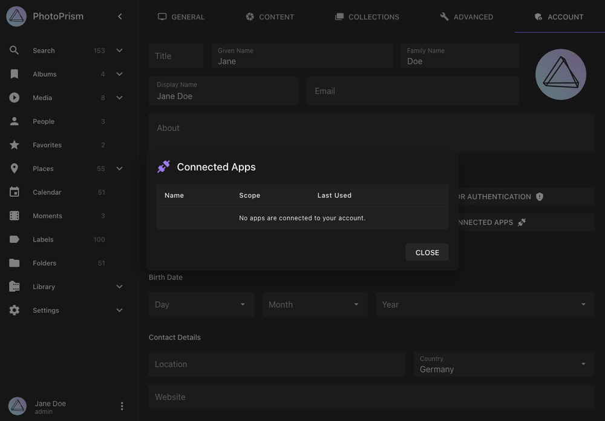

# Connecting AI Agents With MCP

PhotoPrism's [Model Context Protocol (MCP)](https://modelcontextprotocol.io/) server lets compatible AI assistants and agents look up PhotoPrism reference information and search your library. Its tools are read-only: they can find pictures, albums, people, and labels, but cannot edit or delete them.

OAuth is the recommended way to connect an agent. You sign in to PhotoPrism and approve access, while the agent handles authentication for you.

## Before You Start

- Use a PhotoPrism version that includes the [MCP library tools](../../release-notes.md).
- Your agent must support MCP over *Streamable HTTP* with OAuth sign-in and be able to reach your PhotoPrism URL. A remote agent cannot connect to `localhost` on your computer; use a reachable [HTTPS address](../using-https.md).
- MCP must be enabled under [*Settings > Advanced*](../../user-guide/settings/advanced.md#disable-mcp) and for your account. Connecting apps must also be [enabled on your instance](../../developer-guide/api/oauth2.md#configuration).
- Admins can use MCP in all editions, users and viewers in Plus and Pro, and managers in Pro. Contributors, guests, and visitors cannot use it.

## Create a Client in Personal Editions

Register clients from the terminal. The client-management web interface is a Pro feature.

### Register the Client

1. Get the callback URL, also called the *redirect URI*, from your agent's MCP connection settings or documentation.
2. From the directory containing your `compose.yaml`, run the following command. Replace the example callback URL with the exact URL supplied by your agent:

    ```bash
    docker compose exec photoprism photoprism clients add \
      --name "My AI Assistant" \
      --redirect-uri 'https://assistant.example.com/oauth/callback'
    ```

3. Copy the returned *Client ID*. OAuth app clients do not require a client secret.

Replace `photoprism` if your Compose service has a different name. For other installations, run the equivalent `photoprism clients add` command in your terminal.

Depending on your instance's [OAuth Apps setting](../../developer-guide/api/oauth2.md#configuration), agents that publish a client metadata document can connect without manual registration.

### Connect the Agent

1. Open your agent's MCP connection settings and add a remote server with the URL `https://photos.example.com/api/v1/mcp`, using your own PhotoPrism hostname.
2. Select OAuth authentication and enter the *Client ID* from the previous step. If a client secret field is shown, leave it empty.
3. Start the connection. Your agent opens PhotoPrism in a browser, where you sign in to your account.
4. Review the requested permissions and approve access. The agent completes the connection automatically.
5. Try a request such as “Find my latest ten pictures” or “Which PhotoPrism filters can I use to search by date?”

The permissions you approve and your account's visibility rules determine which pictures, albums, people, and labels the agent can access.

## Manage Connected Apps

Open [*Settings > Account > Connected Apps*](../../user-guide/settings/account.md#connected-apps) to review or disconnect an agent. Disconnecting it ends its access until you connect it again.

{ class="shadow" }

## Available Tools

Connected agents can use the following tools to answer your requests.

### Search & Browse Your Library

| Tool               | What Your Agent Can Do                                                              | Example Request                       |
|--------------------|-------------------------------------------------------------------------------------|---------------------------------------|
| `search_media`     | Search pictures and videos with PhotoPrism filters, dates, people, and collections. | “Find videos from last summer.”       |
| `get_media`        | Read a picture's details, files, people, labels, and albums.                        | “Which albums contain this picture?”  |
| `list_collections` | Browse albums, folders, moments, months, or states.                                 | “List my holiday albums.”             |
| `get_collection`   | Read the details of a specific album or collection.                                 | “Show the description of that album.” |
| `list_people`      | List searchable people and their picture counts.                                    | “Which people can I search for?”      |
| `list_labels`      | Find labels and their search slugs.                                                 | “Which labels match flowers?”         |

Ask the agent to continue if you need more results than a tool returns in one request.

### Look Up PhotoPrism Reference Information

| Tool                   | What Your Agent Can Look Up                                            |
|------------------------|------------------------------------------------------------------------|
| `list_config_keys`     | Configuration options, environment variables, CLI flags, and defaults. |
| `find_search_filters`  | Search filters, their types, and usage examples.                       |
| `list_cli_commands`    | Commands and flags available in your edition.                          |
| `list_file_formats`    | Supported file formats and extensions.                                 |
| `list_metadata_fields` | Metadata fields and their corresponding tags.                          |
| `list_thumbnail_sizes` | Supported thumbnail dimensions and uses.                               |

For example, ask “Which RAW formats does PhotoPrism support?” or “What setting controls dynamic previews?” These tools describe options and defaults rather than your instance's current configuration.

## Troubleshooting

- **Connection fails:** Check that the agent can reach your PhotoPrism address and that you entered the `/api/v1/mcp` endpoint.
- **Sign-in is unavailable:** Check that connecting apps is enabled and that the client ID matches a registered OAuth app.
- **Callback URL error:** Register the exact redirect URI supplied by the agent.
- **Access denied:** Check the account's role and MCP setting. If the agent requests additional permissions, review and approve them when you reconnect.
- **Reference lookups work but library searches fail:** Check that you connected to an authenticated instance rather than one running in public mode, which only offers reference information.

See the [MCP API Reference](../../developer-guide/api/mcp.md) for the complete tool reference.
