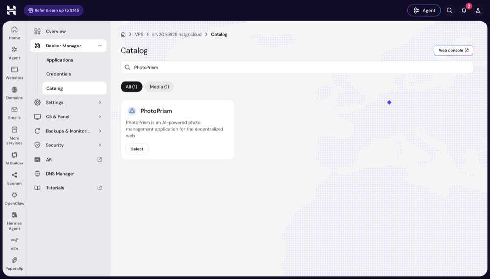
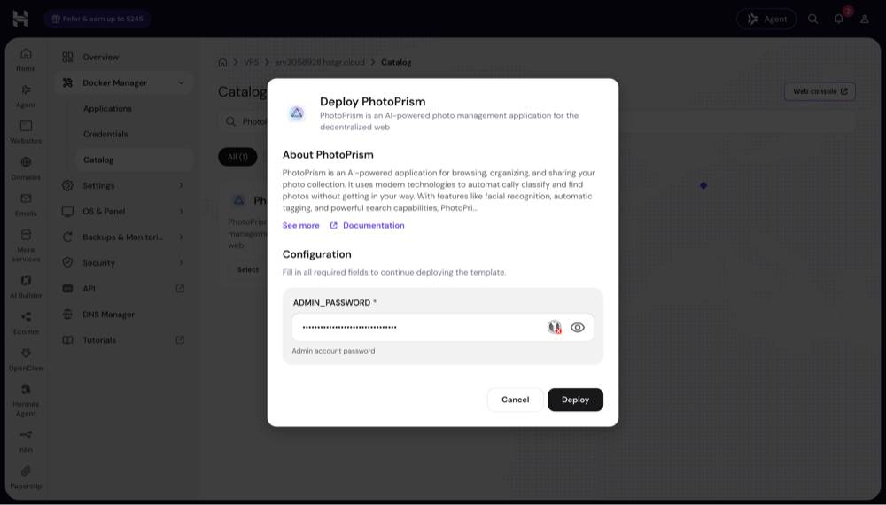
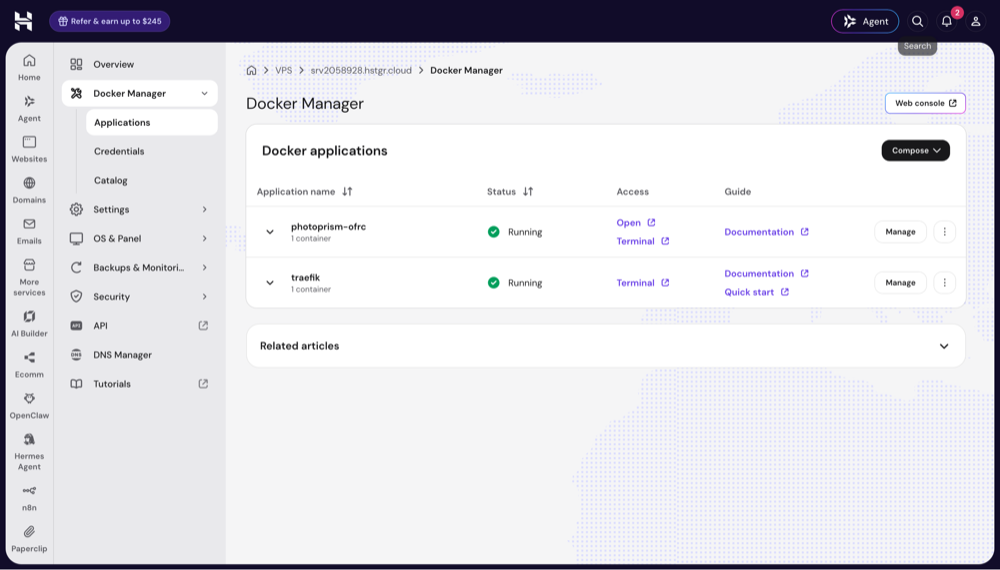
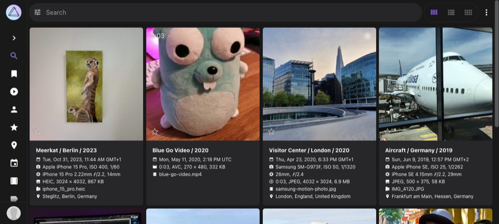

# **Hostinger** VPS Hosting

PhotoPrism can be deployed at Hostinger with a single click through its *Docker Manager*. The installation includes a [Traefik](../proxies/traefik.md) reverse proxy, which obtains a free Let's Encrypt certificate so you can access your instance over HTTPS.

!!! info ""
    This guide covers the PhotoPrism app in Hostinger's *Docker Manager* catalog on a VPS plan. For optional caption generation on the same server, see [AI Captions With Ollama](#ai-captions-with-ollama).

## Setup

### 1. Choose a Plan

We recommend a VPS plan with at least 2 CPU cores and 4 GB of memory.

Indexing, face recognition, and video transcoding share the available CPU resources. Processing RAW images and videos can be slow on a server with only one core.

!!! info ""
    [RAW image conversion and face recognition are disabled](../../user-guide/settings/advanced.md) on instances with 1 GB or less memory. We take no responsibility for [instability or performance problems](../troubleshooting/performance.md) if your server does not [meet the system requirements](../index.md#system-requirements).

### 2. Deploy PhotoPrism

- [Log in](https://auth.hostinger.com/en/login) to your Hostinger account
- Go to *VPS*, select your server, and open the *Docker Manager*
- Switch to the *Catalog* tab, search for "PhotoPrism", and click *Select*

{ class="shadow" }

- Enter the password for the "admin" account and click *Deploy*

{ class="shadow" }

Hostinger then creates two applications, `photoprism-<name>` and `traefik`. Replace `photoprism-<name>` in the examples below with the application name shown in the Docker Manager. The deployment takes about a minute and writes its log to `/docker/photoprism-<name>/.build.log` on the server.

### 3. Open PhotoPrism

As soon as both applications show *Running*, click *Open* in the PhotoPrism row:

{ class="shadow" }

PhotoPrism opens over HTTPS at the hostname assigned to your application, for example `https://photoprism-example.srv123456.hstgr.cloud`. Sign in with the username "admin" and the password you entered during the deployment. You can [change your password](../../user-guide/settings/account.md#change-password) in *Settings > Account*.

!!! warning "Your Instance Is Also Reachable Without Encryption"
    The catalog deployment also exposes PhotoPrism over HTTP on a randomly assigned server port. Run `docker port photoprism-<name>-photoprism-1` in a server terminal to find this port, which may change when the application is recreated. Use the HTTPS address shown in the Docker Manager when accessing or sharing your instance.

### 4. First Steps 👣

After signing in, add your pictures through [browser uploads](../../user-guide/library/upload.md) or [WebDAV](../../user-guide/sync/webdav.md):

{ class="shadow" }

Our [First Steps Tutorial](../../user-guide/first-steps.md) introduces the user interface and library settings.

!!! info ""
    The default configuration does not mount an [import folder](../advanced/docker-volumes.md#import-folder). Browser uploads and WebDAV work without changing the Compose file.

## Terminal Access

You can open a terminal in the hPanel user interface:

- The *Web console* button in the Docker Manager opens a server terminal in a new browser tab.
- The *Terminal* link in the *Access* column of an application's row opens a terminal for that application.

To connect over SSH, add your public key under *VPS > Settings > SSH keys* with *+ SSH key*, then run `ssh root@<your-server>` from your computer. Replace `<your-server>` with your server's IP address or hostname.

Run the Docker and Docker Compose commands in this guide in a server terminal, using the *Web console* or SSH. To use PhotoPrism's command-line interface from there, prefix its commands with `docker exec`:

```bash
docker exec photoprism-<name>-photoprism-1 photoprism status
docker exec photoprism-<name>-photoprism-1 photoprism index
docker exec photoprism-<name>-photoprism-1 photoprism faces status
docker exec photoprism-<name>-photoprism-1 photoprism backup -i -f
```

If you use the application's *Terminal* instead, run the `photoprism` commands directly, without the `docker exec photoprism-<name>-photoprism-1` prefix.

!!! info ""
    The deployment runs the PhotoPrism container as root. See our [Docker Security Guide](../advanced/docker-security.md#run-services-as-non-root-user) for instructions on running it as a non-root user. After verifying that SSH key authentication works, disable SSH password authentication and review the firewall settings in hPanel.

## Updates

The deployment uses the `latest` image tags for PhotoPrism and Traefik. Containers must be updated separately from the server's operating system.

Create a [backup](#backups) before updating. Then open a server terminal, change to your application's directory, and pull the latest images:

```bash
cd /docker/photoprism-<name>
docker compose pull
docker compose up -d
```

After the update, check the application log with `docker compose logs -f photoprism`. You can also update the application through the Docker Manager.

[Learn more ›](../updates.md)

## Backups

The installation stores your pictures in the `photoprism-<name>_photoprism_originals` Docker volume. The `photoprism-<name>_photoprism_storage` volume contains the SQLite index database, configuration, cache, and backup files. Both volumes are stored below `/var/lib/docker/volumes/` on the server.

PhotoPrism's default configuration creates daily database backups and retains up to three SQL dumps. You can change the schedule and retention limits in the [backup configuration](../config-options.md#backup).

To create a database backup manually, run:

```bash
docker exec photoprism-<name>-photoprism-1 photoprism backup -i -f
```

With the default Docker image configuration, the dump is saved as `/photoprism/storage/backups/sqlite3/<date>.sql` inside the container. The corresponding path on the host is `/var/lib/docker/volumes/photoprism-<name>_photoprism_storage/_data/backups/sqlite3/`.

These database backups remain on the same server. For a full backup, also copy your *originals* and *storage* volumes to a separate location, as described in our [Backup Guide](../../user-guide/backups/index.md).

To restore a dump, stop PhotoPrism and mount its existing volumes in a temporary container. Replace `<file>` with the SQL dump filename:

```bash
docker stop photoprism-<name>-photoprism-1
docker run --rm --entrypoint sh \
  -e PHOTOPRISM_STORAGE_PATH=/photoprism/storage \
  -e PHOTOPRISM_ORIGINALS_PATH=/photoprism/originals \
  -v photoprism-<name>_photoprism_storage:/photoprism/storage \
  -v photoprism-<name>_photoprism_originals:/photoprism/originals \
  photoprism/photoprism:latest -c "photoprism restore -i -f /photoprism/storage/backups/sqlite3/<file>.sql"
docker start photoprism-<name>-photoprism-1
```

Restoring a database backup does not restore or remove original files. Files that remain in the *originals* volume can be indexed again during the next scan.

[Learn more ›](../../user-guide/backups/restore.md)

## Domains & HTTPS

Your instance receives a valid Let's Encrypt certificate for the Hostinger hostname by default. Traefik renews this certificate automatically.

To use your own domain, follow [Hostinger's Docker Domain Guide](https://www.hostinger.com/support/how-to-change-the-domain-of-a-docker-project/):

1. Create an A record for your hostname, for example `photos.example.com`, pointing to your VPS IP address. If your domain uses Hostinger nameservers, you can [manage its DNS records in hPanel](https://www.hostinger.com/support/8907694-how-to-create-a-subdomain-without-a-hosting-plan-at-hostinger/). Otherwise, use your DNS provider's dashboard.
2. In hPanel, open *VPS > Manage > Docker Manager*, select your PhotoPrism project, and click *Manage* to open the YAML editor.
3. Update the existing Traefik router rules in the `photoprism` service's `labels` section to use your full hostname, for example ``Host(`photos.example.com`)``. Keep the existing router names and update both HTTP and HTTPS rules if present.
4. Set the `photoprism` service's [`PHOTOPRISM_SITE_URL`](../config-options.md#site-information) environment variable to `https://photos.example.com/` so generated links use the new address.
5. Click *Deploy* to apply the changes. Traefik will request a Let's Encrypt certificate for the new hostname. Allow 1-3 minutes, then open your HTTPS address.

If an existing router rule combines `${COMPOSE_PROJECT_NAME}` and `${TRAEFIK_HOST}`, changing `TRAEFIK_HOST` alone also keeps the project name as a hostname prefix. Set the complete hostname in the router's `Host` rule as described above.

!!! warning ""
    Always use HTTPS when accessing PhotoPrism over the Internet to protect your files and passwords.

[Learn more ›](../using-https.md)

## AI Captions With Ollama

You can optionally run [Ollama](../../user-guide/ai/using-ollama.md) on the same server to generate captions with a local vision model. The example below makes its API available to PhotoPrism over the Docker network and to the server over localhost.

### Step 1: Install Ollama

Create the `/docker/ollama` directory on your server, then save the following as `/docker/ollama/docker-compose.yml`. Replace `photoprism-<name>_default` with your application's Docker network name:

```yaml
services:
  ollama:
    image: ollama/ollama:latest
    restart: unless-stopped
    ports:
      - "127.0.0.1:11434:11434"
    mem_limit: 4g
    volumes:
      - ollama_models:/root/.ollama
    networks:
      - photoprism

volumes:
  ollama_models:

networks:
  photoprism:
    name: photoprism-<name>_default
    external: true
```

To check the network name, run `docker network ls` in a server terminal. Start Ollama from its own directory:

```bash
cd /docker/ollama
docker compose up -d
```

### Step 2: Download a Model

From the `/docker/ollama` directory, download the model:

```bash
docker compose exec ollama ollama pull minicpm-v4.6:1b
```

### Step 3: Configure PhotoPrism

Add these variables to the existing `environment` list of the `photoprism` service in `/docker/photoprism-<name>/docker-compose.yml`:

```yaml
      - OLLAMA_BASE_URL=http://ollama:11434
      - OLLAMA_MODEL=minicpm-v4.6:1b
```

Then recreate the PhotoPrism service to apply the environment variables:

```bash
cd /docker/photoprism-<name>
docker compose up -d
```

Create or edit `vision.yml` in PhotoPrism's *storage/config* folder, which is located at `/photoprism/storage/config/` inside the container. Add the following model to generate captions for newly indexed pictures:

```yaml
Models:
  - Type: caption
    Model: minicpm-v4.6:1b
    Engine: ollama
    Run: newly-indexed
    Service:
      Uri: ${OLLAMA_BASE_URL}/api/generate
      Think: "false"
```

Captions for newly indexed pictures are generated by background workers, so they may appear a few minutes after an upload.

!!! info ""
    On a server with 8 GB of memory, we recommend a small model such as `minicpm-v4.6:1b` to leave enough memory for indexing, face recognition, and video transcoding.

[Learn more ›](../../user-guide/ai/index.md)
