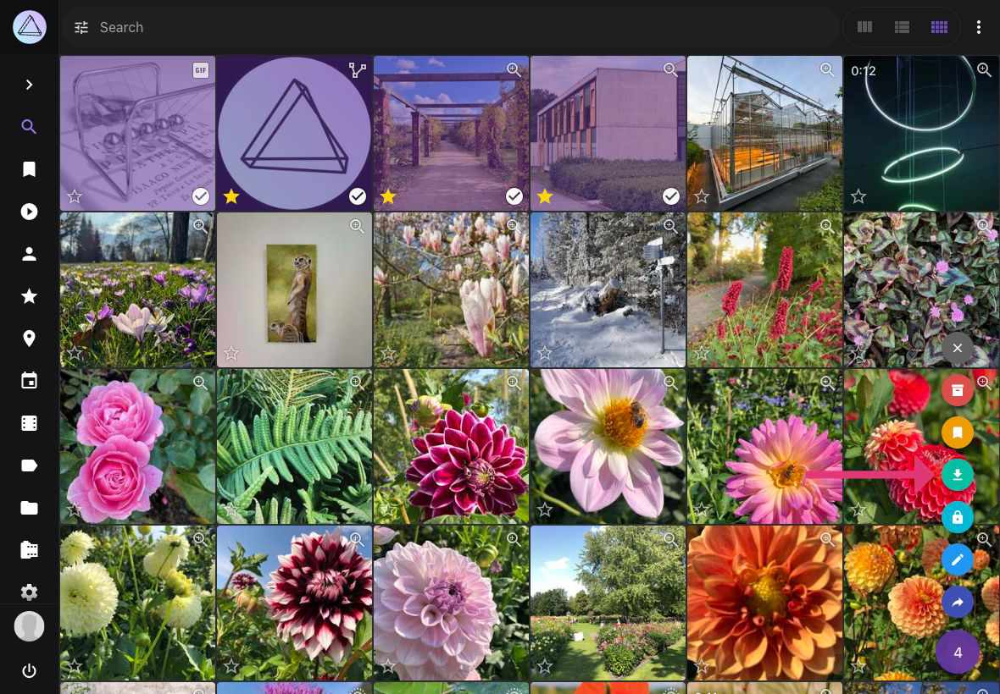
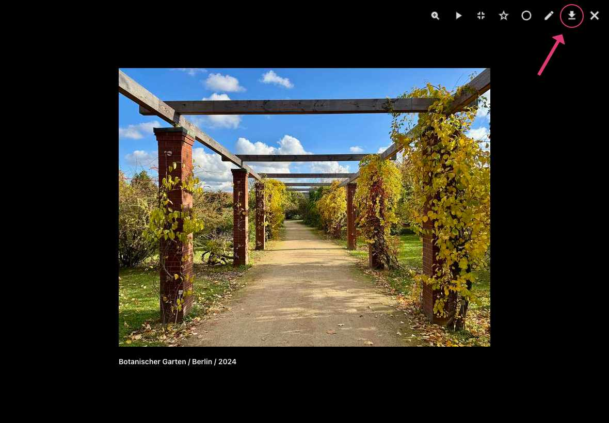
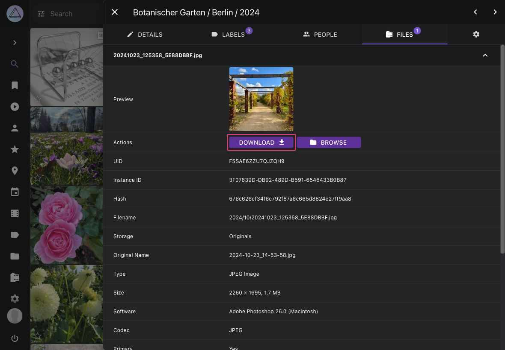

# Downloading Files #

=== "Using Context Menu"
     1. Select photos
     2. Click on the context menu
     3. Click :material-cloud-download:. Photos will be downloaded in original size

        { class="shadow" }

    !!! tip ""
        You can select [many photos at once](../navigate.md#selection-mode-and-multi-select) using shift.

    !!! info ""
        You can [configure](../settings/library.md#download) which files should be downloaded for each photo.

=== "From Fullscreen Mode"
     1. Click on the photo
     2. In fullscreen mode click :material-download:

        { class="shadow" }

    !!! info ""
        You can [configure](../settings/library.md#download) which files should be downloaded for each photo.

    !!! tip "Keyboard Shortcut"
        In the fullscreen viewer, you can quickly download files by pressing **Ctrl + D**.

=== "From Edit Dialog"
    1. Open the photo's  [*edit dialog*](edit.md)
    2. Open the *Files Tab*
    3. Click *Download*

       { class="shadow" }

## Exporting in Different Formats and Sizes ##

To save a picture in a specific size or format instead of downloading its original files, open it in fullscreen mode and choose *Export* from the menu, which is listed above *Download*. You can also press **Ctrl + Shift + E**.

The dialog lists each original file of the picture's [stack](stacks.md) together with the outputs available for it:

- **Original:** the file as it is stored in your library.
- **Full-Size Preview:** an existing JPEG or PNG preview of an original that is not an image format browsers can display, such as a RAW file.
- **Resized JPEGs:** copies scaled down to standard sizes that fit the original, named like `IMG_0001_1920.jpg`.
- **Video renditions:** a playable MP4 for videos that do not use AVC, animations, and live photos. If a rendition has not been created yet, the download starts after transcoding.

Select the outputs you need and click *Export*. Your browser then saves them one after the other, so it may ask for permission to download multiple files. If a download fails, you can retry it from the dialog.

!!! info ""
    *Export* is available to [roles](../users/roles.md) with full access to the library, such as *Admin* and *User*. *Viewers*, *Guests*, and *Visitors* can download files but cannot export them. It can be turned off under [*Settings > General*](../settings/general.md#export).
