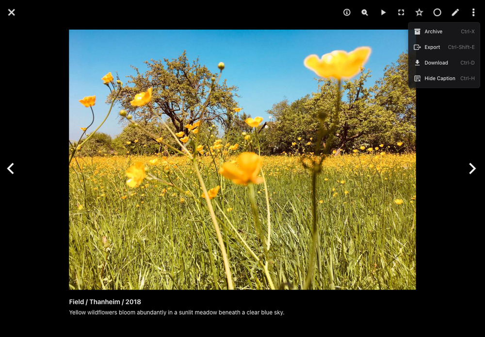
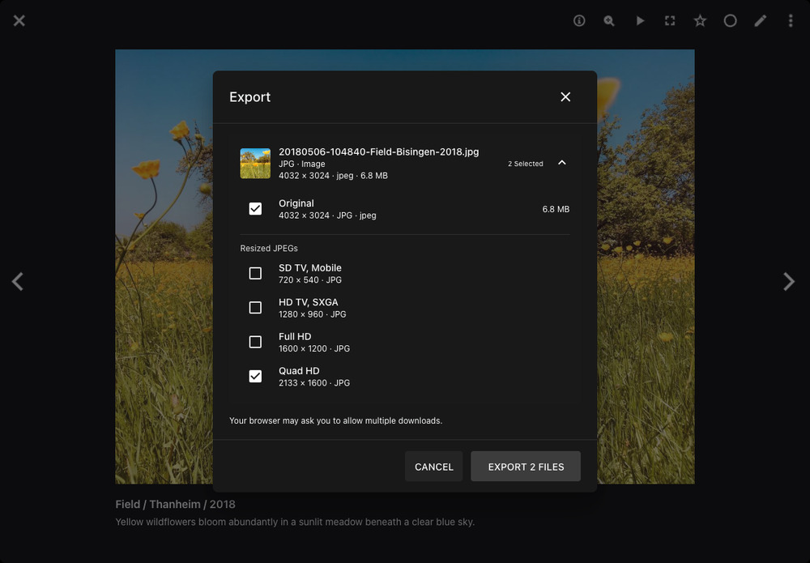

# Export

Use the *Export* dialog to save originals, full-size previews, resized JPEGs, or compatible videos to your device. You can choose several versions of the picture or video open in the [fullscreen viewer](../navigate.md).

## Exporting Files

1. Click a picture or video to open it in fullscreen mode.
2. Open the viewer's menu and select *Export*.

    { class="shadow" }

3. Expand a file group to see its options. [Stacks](stacks.md) can contain several originals, each with its own group.
4. Select the versions you want to save, such as *Original*, *Full-Size Preview*, or a size under *Resized JPEGs*.

    { class="shadow" }

5. Click *Export 1 File* or *Export N Files*. Allow multiple downloads if your browser asks.
6. Wait for any video conversion to finish. If a file fails to download, click *Retry* next to it.

!!! tip "Keyboard Shortcut"
    In the fullscreen viewer, press **Ctrl + Shift + E**, or **Command + Shift + E** on macOS, to open Export.

Files are downloaded separately. Closing the dialog cancels pending exports; downloads already started in your browser continue.

## File Types

| File Type                                                | Available Versions                                                                                                                    |
|----------------------------------------------------------|---------------------------------------------------------------------------------------------------------------------------------------|
| JPEG and PNG                                             | Original file and resized JPEGs.                                                                                                      |
| RAW and other images, such as HEIC, AVIF, WebP, and TIFF | Original file, an available full-size preview, and resized JPEGs.                                                                     |
| Vector graphics                                          | Original file, an available full-size preview, usually PNG, and resized JPEGs.                                                        |
| PDF documents                                            | Original PDF, a full-size preview of the first page, and resized JPEGs of that page.                                                  |
| Videos                                                   | Original video, available still previews and resized JPEGs, and a *Compatible Video* (MP4/H.264) when conversion is needed.           |
| Animations                                               | Original animation, available still previews and resized JPEGs, and a compatible MP4 video.                                           |
| Live Photos                                              | Original files, available still previews and resized JPEGs, and a *Video Part*. Separate image and video files have their own groups. |
| Insta360 INSV and LRV videos                             | Original file and available still previews. A compatible video is offered if PhotoPrism has already converted it.                     |

Preview choices depend on the previews PhotoPrism has already created. If *No preview image available* appears, you can still export the original. Previews stored as originals have their own file groups.

Audio, metadata files such as XMP, JSON, and YAML, and missing or unreadable files are not offered.

## Settings

### Enable Export

Administrators can turn *Export* on or off under [*Settings > General*](../settings/general.md#export). It is enabled by default.

The separate *Download* switch and the file choices under *Settings > Content > Download* apply to the [Download actions](download.md). Export uses its own switch and the versions you select in the dialog.

### Static & Dynamic Previews

The settings under [*Settings > Advanced > Preview Images*](../settings/advanced.md#preview-images) control the available JPEG sizes:

- With *Dynamic Previews* off, sizes are limited to the *Static Size Limit*.
- With *Dynamic Previews* on, larger sizes can be created when needed, up to the *Dynamic Size Limit*. This limit is always at least as high as the static limit.
- Previews up to the static limit are created during indexing. Larger previews may take longer to download because they are created on demand.

Images keep their proportions and are never enlarged beyond their original size. Smaller pictures therefore offer fewer size choices.

These limits do not restrict original downloads or existing full-size previews. The latter also depend on your [JPEG and PNG size limits](../settings/advanced.md#image-quality).
